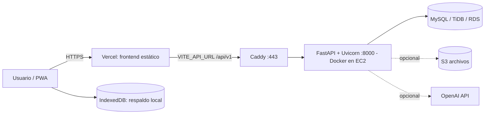
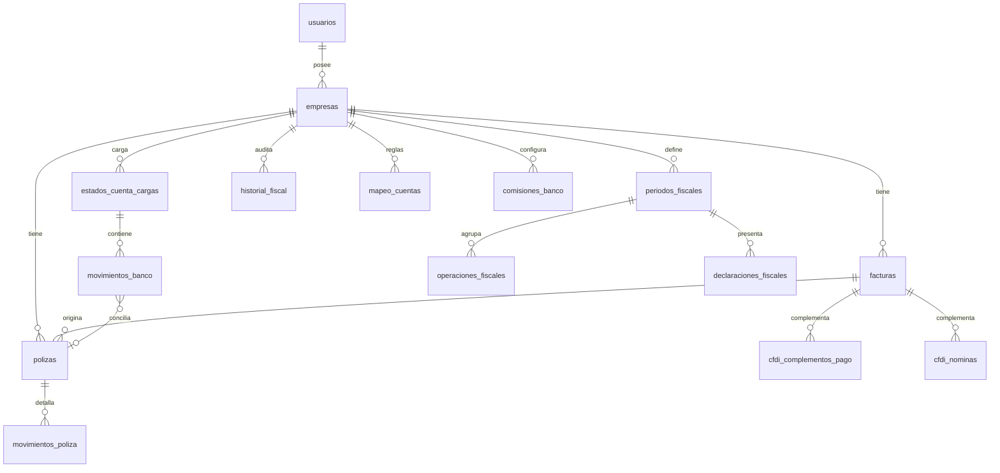

# SmartContable — Arquitectura de la aplicación

> Descripción de capas, flujos y decisiones de diseño. Complementa
> [ESTRUCTURA_PROYECTO.md](./ESTRUCTURA_PROYECTO.md) y [REPORTE_TECNICO_CLONACION.md](./REPORTE_TECNICO_CLONACION.md).

## 1. Visión

SaaS multiempresa de automatización fiscal y contable para México: importa CFDI 4.0, genera pólizas,
concilia estados de cuenta, calcula ISR/IVA/IEPS/DIOT, y presenta KPIs e informes ejecutivos.

## 2. Diagrama de despliegue



## 3. Capas del backend

```text
Endpoint (api/v1/endpoints)  →  Service (services/)  →  Modelos ORM (models/)  →  DB
        │ Pydantic (schemas/)        │ reglas de negocio
        └ Depends: get_db, get_current_user, require_roles
```

Reglas (de `AGENTS.md`): endpoints delgados (recibir, validar, llamar servicio, responder); lógica de
negocio en `services/`; consultas complejas aisladas; no exponer secretos ni credenciales SAT.
> Nota: el directorio `repositories/` descrito en AGENTS.md aún **no existe**; hoy los servicios
> consultan SQLAlchemy directamente. Al clonar, conviene introducirlo para consultas complejas.

### Componentes transversales (`app/core`)

| Módulo | Función |
|---|---|
| `config.py` | `Settings` (pydantic-settings) desde `.env`; valida `SECRET_KEY ≥ 32` y `DEBUG=False` en producción |
| `database.py` | Engine/Session SQLAlchemy con pool configurable (`DATABASE_POOL_*`) |
| `security.py`, `dependencies.py` | Hash bcrypt, emisión/validación JWT (HS256), `get_current_user` |
| `permissions.py` | `require_roles(*roles)` → 403 si el rol no está permitido |
| `tenancy_validators.py` | `validar_empresa_pertenece_usuario`, `validar_factura_…`, `validar_poliza_…`, `get_usuario_empresas` |
| `exceptions.py` | `SmartContableException` → respuesta `{"error": {"code","message"}}` |
| `sat_fiscal.py`, `tarifas_isr_oficiales.py` | Catálogos y tarifas fiscales |

### Ciclo de vida y errores (`main.py`)

- Desarrollo: `Base.metadata.create_all`. Producción: el esquema se gestiona **solo con Alembic**.
- Manejadores: `SmartContableException`, `IntegrityError` (409), `SQLAlchemyError` (500, detalle solo con DEBUG), `Exception` (500).
- CORS por `CORS_ORIGINS` + regex para localhost; `Content-Disposition` expuesto para descargas.
- Salud: `GET /health` (liveness) y `GET /ready` (consulta `SELECT 1`).

## 4. Modelo de datos

Todas las entidades de negocio cuelgan de `empresas` (`empresa_id`) para el aislamiento multiempresa.



| Tabla | Notas clave |
|---|---|
| `usuarios` | email, `password_hash`, rol, `creado_en` |
| `empresas` | rfc, razón social, tipo persona, régimen, `opcion_deduccion`, CP, `activo`, timestamps |
| `facturas` | UUID fiscal, `tipo_comprobante` (enum), impuestos, impuestos locales, concepto, claves S3 |
| `polizas` / `movimientos_poliza` | Partida doble; `anio`, tipo (ingreso/egreso/diario) |
| `estados_cuenta_cargas` | `hash_archivo` (evita duplicados), `archivo_s3_key` |
| `movimientos_banco` | tipo abono/cargo, monto, saldo, `hash_movimiento`, `poliza_id`, `modo_conciliacion` (automático/manual), `tipo_asignacion` |
| `periodos_fiscales` / `operaciones_fiscales` | Base gravable, IVA trasladado/acreditable/retenido, ISR retenido, IEPS, DIOT |
| `declaraciones_fiscales` | Versionadas (`version`, `es_vigente`, `version_anterior_id`), `snapshot_calculo` |
| `historial_fiscal` | Bitácora antes/después con motivo |
| `pagos_provisionales_anteriores`, `perdidas_fiscales` | Ajustes del ejercicio |
| `cfdi_complementos_pago`, `cfdi_pago_documentos`, `cfdi_nominas`, `cfdi_nomina_lineas`, `cfdi_clasificaciones_especiales` | Complementos CFDI |
| `mapeo_cuentas` | Reglas configurables (RFC / palabra clave / prefijo) → cuenta contable |
| `comisiones_banco` | % crédito/débito/servicios y comisión fija por banco |

Migraciones: `backend/alembic/versions/` (esquema inicial, fiscal, historial de declaraciones,
complementos CFDI, pagos provisionales/pérdidas, claves S3, estado de conciliación, opciones fiscales,
concepto de factura, mapeo de cuentas, ampliación de serie).

## 5. API (`/api/v1`)

| Prefijo | Endpoints principales |
|---|---|
| `/auth` | `POST /registro`, `POST /login`, `POST /recuperar-contrasena` |
| `/empresas` | CRUD, `GET /{id}/fiscal`, `GET /{id}/exportar`, `GET /{id}/exportar-csv`, `DELETE /{id}/periodo` |
| `/facturas` | `POST /subir-xml`, `POST /subir-zip`, listado, `GET /global`, `GET /{id}/detalle`, `POST /{id}/generar-poliza`, `GET /{id}/poliza`, `DELETE /{id}` |
| `/cfdi-complementos` | `GET /pagos`, `/nominas`, `/retenciones-terceros` |
| `/polizas` | `POST /diario`, `/desde-movimiento-banco`, `/generar-automatico`, `/generar-desde-factura/{id}`; `GET /`, `/organizadas`, `/descargar-csv`, `/{id}` |
| `/conciliacion` | `POST /estado-cuenta`, `POST /auto-conciliar`, `PATCH /movimientos/{id}`, `POST /convertir-pdf-csv`; `GET /resumen`, `/movimientos`, `/estados-cuenta`, `/bancos-catalogo`; `DELETE /estados-cuenta/{id}` |
| `/configuracion` | `/mapeos`, `/comisiones-banco` (alta, consulta, edición, baja) |
| `/fiscal` | `/isr`, `/iva`, `/ieps`, `/anual`, `/resumen-sat`, `/tarifas-isr/{ejercicio}`, periodos, operaciones, declaraciones (+presentar/modificar/cancelar), `/historial`, pagos provisionales, pérdidas, `/diot` y `/diot/export`, `/diferencias`, `/indicadores`, `/indicadores/revision` |
| `/reportes` | `/paquete-fiscal`, `/financiero`, `/desglose-gastos`, `/kpis`, `/global-kpis` |

Documentación interactiva: `/docs` (Swagger) del backend. Referencia ampliada: [API_REFERENCE.md](./API_REFERENCE.md).

## 6. Flujos principales

**Ingesta CFDI** — `subir-xml|zip` → límites (`MAX_*`) → `defusedxml`/lxml → `sat_parser` valida CFDI 4.0 →
upsert por UUID (manejo de cancelaciones/sustituciones) → `clasificador` + `mapeo_cuentas` → operaciones fiscales y póliza opcional.

**Conciliación** — PDF/CSV de estado de cuenta → `bank_parser` (BBVA/genérico) o agente IA (`gpt-4o-mini`, requiere `OPENAI_API_KEY`) →
`hash_movimiento` evita duplicados → `auto-conciliar` contra facturas/pólizas → asignación manual vía `PATCH`.

**Fiscal** — operaciones por periodo → `calculos_fiscales` (ISR/IVA/IEPS, pagos provisionales, pérdidas) →
declaración versionada con snapshot y bitácora en `historial_fiscal`.

## 7. Arquitectura del frontend

- **SPA React 19 + Vite + Tailwind 4**, rutas protegidas por `localStorage.token` (`App.jsx`).
- **`services/api.js`**: axios con `Authorization: Bearer`, redirección a `/login` ante 401 y guardado de snapshots GET para uso offline.
- **Navegación ejecutiva** (`navigation/executive.js`): sidebar (Dashboard, CFDI, Contabilidad, Bancos, SAT, Inteligencia, Informes, Configuración).
  Las categorías de Inteligencia declaran su `fuente`: `movimientos` (historial CFDI con filtro ingresos/egresos), `informes`, `fiscal`, `bancos`, `balance`.
- **`CompanyDetail.jsx`** orquesta módulos/vistas y resuelve destinos con `irADestino`; `?movimiento=ingresos|egresos` sincroniza el filtro del historial.
- **Dashboard de empresas**: cabecera azul compacta, buscador, tarjetas de empresa y, al final, “Administración y respaldos”.
- **Respaldo local** (`localBackup.js`/`backupCore.js`): IndexedDB + exportación ZIP; empresas locales con id `local-*`; operación sin nube.
- **PWA**: `sw.js` con `APP_VERSION`; al publicar, subir la versión en `sw.js`, `index.html` (`?v=`) y `manifest.webmanifest`.

## 8. Seguridad

JWT HS256 (480 min por defecto), bcrypt, validación de pertenencia empresa↔usuario en cada operación,
límites de carga, `defusedxml`, CORS restringido, `DEBUG` prohibido en producción, secretos solo por variables de entorno.
Pendientes recomendados: rate limiting (`slowapi` instalado), rotación de claves, roles granulares por empresa.

## 9. Observabilidad

Logging estructurado (`logging_config.py`, `python-json-logger`), `/health` y `/ready` para balanceadores.
